# Campus EventHub 🎪

<div align="center">

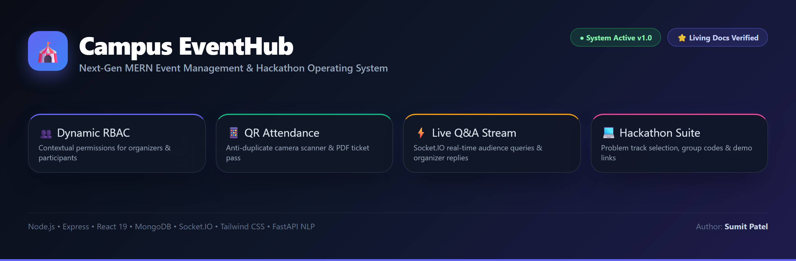

[](https://react.dev/)
[](https://vitejs.dev/)
[](https://nodejs.org/)
[](https://expressjs.com/)
[](https://www.mongodb.com/)
[](https://socket.io/)
[](https://tailwindcss.com/)
[](.github/workflows/architecture-gate.yml)
[](LICENSE)

**Next-Generation Multi-Tenant Event Management & Hackathon Operating System for Universities.**

[Live Application](#getting-started) • [Route → Table Visualizer](#-interactive-route--table-architecture-map) • [Database Architecture](#database-models--architecture) • [LinkedIn Assets](#linkedin-assets--social-showcase) • [Key Features](#key-features) • [Living Documentation](#living-documentation)

---

</div>

## 📌 Executive Summary

**Campus EventHub** replaces fragmented Google Forms, manual spreadsheets, and disconnected messaging groups with an enterprise-grade, single-shell SaaS platform. Built on the **MERN** stack with **Socket.IO** and **FastAPI NLP**, it orchestrates the entire university event lifecycle: from registration and AI identity verification to anti-duplicate QR attendance scanning, live WebSocket Q&A, and automated PDF certification.

---

## 🗺️ Interactive Route → Table Architecture Map

Campus EventHub includes a built-in **AST Route-to-Table Visualizer & Security Inspector** directly in the admin portal (`/admin/health`) and public developer documentation (`/api-docs`):

<div align="center">

[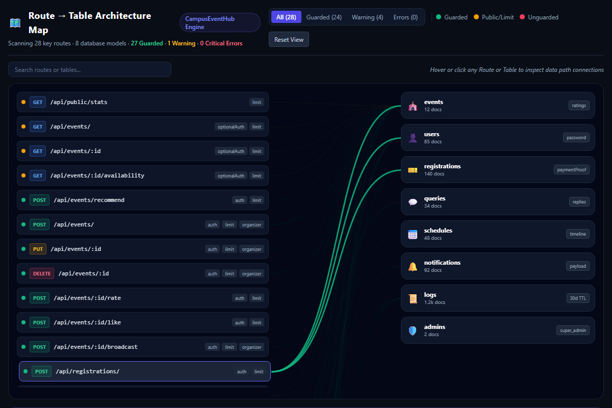](docs/assets/images/custom-route-table-map.png)

*Interactive Sankey visualizer mapping 28 API routes to 8 collections with real-time guard verification.*

</div>

- **Dynamic Path Tracing**: Bezier curves map which API routes read or write to which collections.
- **Automated Security Gate**: Enforces zero unauthenticated routes reach sensitive personal records (`password`, `emailVerificationToken`, private profiles).
- **Run Locally**:
  ```bash
  python scripts/scan_architecture.py
  ```

---

## 🚀 LinkedIn Assets & Social Showcase

> **Ready-to-Post LinkedIn Graphic**: Designed specifically for 16:9 LinkedIn feed presentations, portfolios, and tech case studies.

<div align="center">

[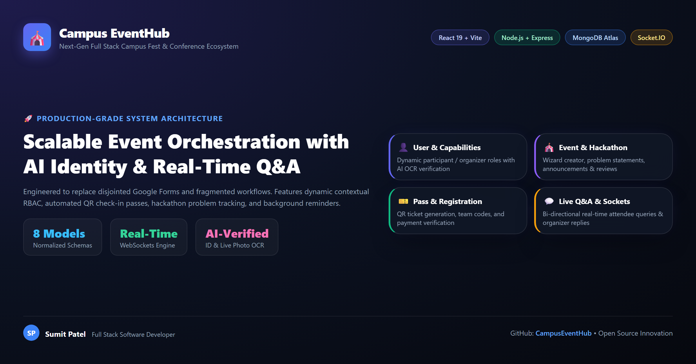](docs/assets/images/campus-eventhub-linkedin-showcase.png)

*High-resolution asset available at [`docs/assets/images/campus-eventhub-linkedin-showcase.png`](docs/assets/images/campus-eventhub-linkedin-showcase.png) or [`frontend/public/showcase/campus-eventhub-linkedin-showcase.png`](frontend/public/showcase/campus-eventhub-linkedin-showcase.png).*

</div>

---

## 🗄️ Database Models & Architecture

The system features **8 normalized Mongoose models** designed with strict relational integrity, compound indexes, and dynamic RBAC scoping.

### 🌟 Master Models Collection Infographic

The infographic below illustrates the complete data model topology across all 8 entities:

<div align="center">

[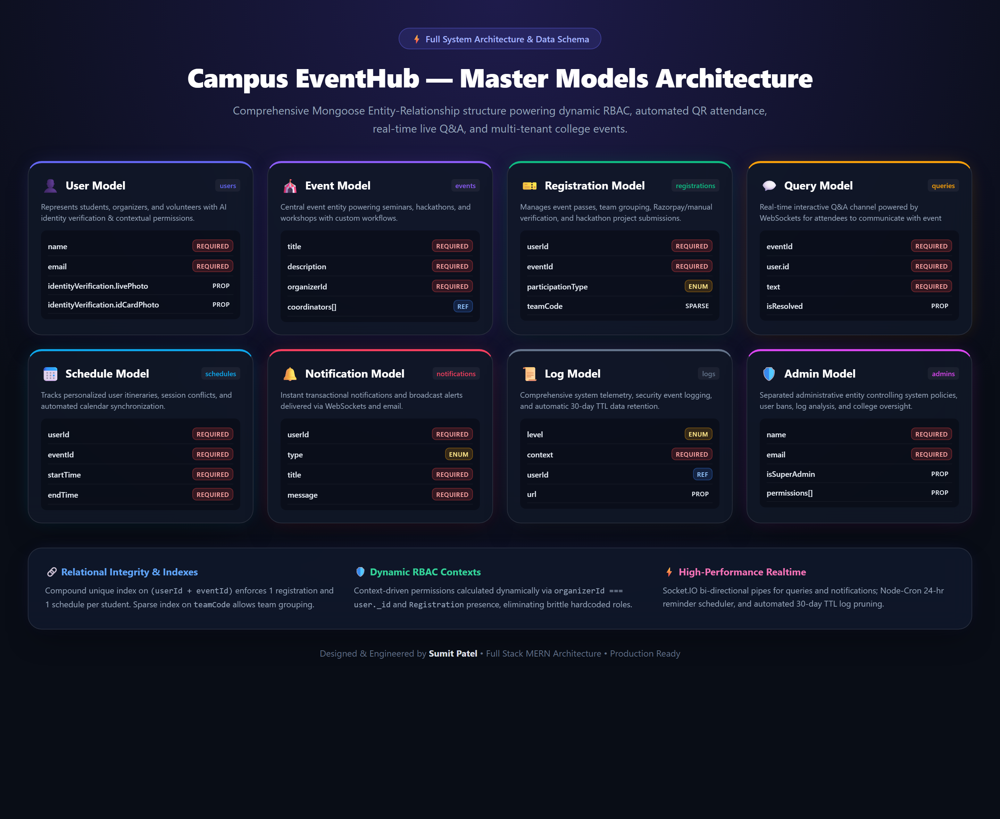](docs/assets/images/campus-eventhub-models-collection.png)

</div>

---

### 🧩 Detailed Model Breakdown & Schema Cards

Click any model below to view its schema, constraints, indexes, and field definitions:

<details open>
<summary><b>1. User Model (<code>users</code>)</b> — Core Identity, AI ID Verification & Contextual Capabilities</summary>

<br>

<div align="center">
  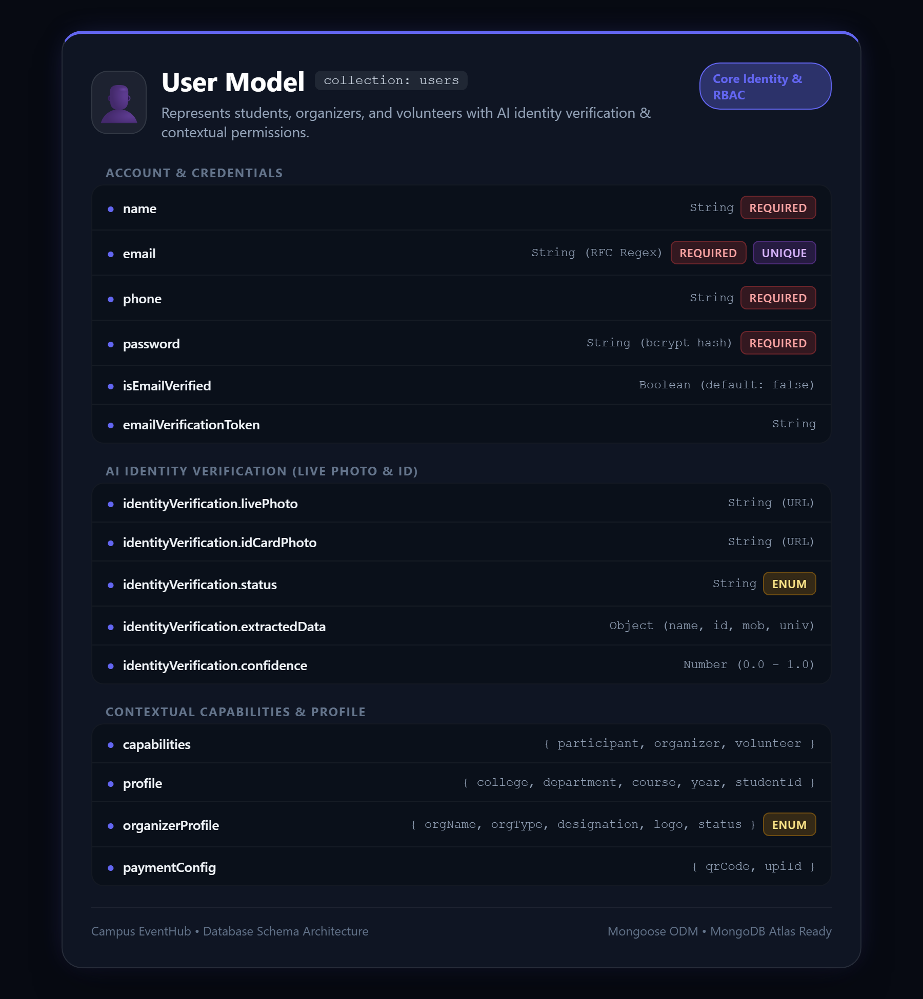
</div>

- **Key Highlights**:
  - Encrypted credentials with bcrypt and strict email validation.
  - **AI Identity Verification**: Extracts name, ID number, and college from live student card photos with OCR confidence scores.
  - **Contextual Capabilities**: Granular flags (`participant`, `organizer`, `volunteer`) powering dynamic navigation.
  - **Organizer Profile & Payments**: UPI ID & QR code storage for manual ticket verification.
</details>

<details>
<summary><b>2. Event Model (<code>events</code>)</b> — Event Engine, Hackathons & Coordinators</summary>

<br>

<div align="center">
  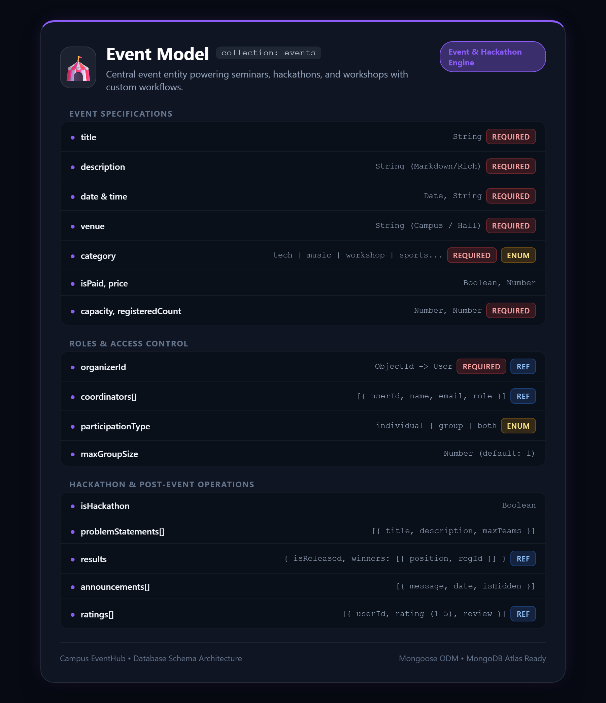
</div>

- **Key Highlights**:
  - Comprehensive metadata: date, time, venue, category, pricing, and live capacity tracking.
  - **Hackathon Suite**: Multi-track problem statements with maximum team capacities.
  - **Volunteer & Coordinator Mapping**: User references with scoped permissions.
  - **Post-Event Results**: Winner announcements, verified certificate links, and attendee ratings (1–5 stars).
</details>

<details>
<summary><b>3. Registration Model (<code>registrations</code>)</b> — Passes, Team Codes & Submissions</summary>

<br>

<div align="center">
  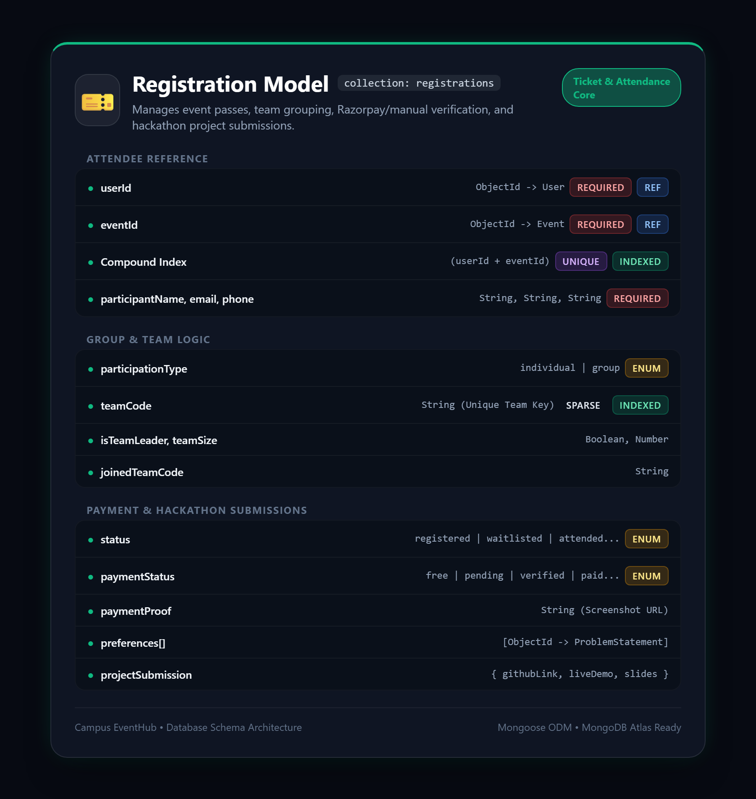
</div>

- **Key Highlights**:
  - **Compound Unique Index**: `(userId + eventId)` prevents duplicate bookings per attendee.
  - **Team Logic**: `sparse` indexed `teamCode`, leader assignment, and group size controls.
  - **Hackathon Submissions**: Direct links for GitHub repositories, live demo URLs, and presentation slide decks.
  - **Payment Verification**: Manual proof screenshot upload or automated Razorpay status tracking.
</details>

<details>
<summary><b>4. Query Model (<code>queries</code>)</b> — Real-Time Live Q&A Stream</summary>

<br>

<div align="center">
  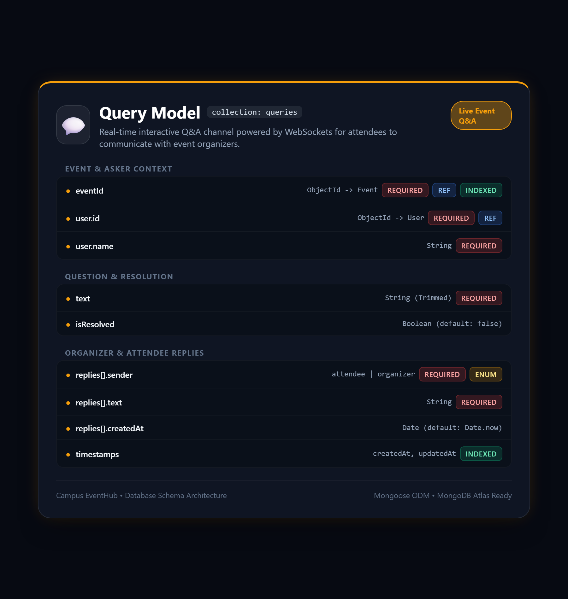
</div>

- **Key Highlights**:
  - Event-scoped Q&A channel powered by WebSockets.
  - Categorized conversation threads between attendees and organizers.
  - Real-time resolution toggling (`isResolved`) with audit timestamps.
</details>

<details>
<summary><b>5. Schedule Model (<code>schedules</code>)</b> — Personalized Student Itinerary</summary>

<br>

<div align="center">
  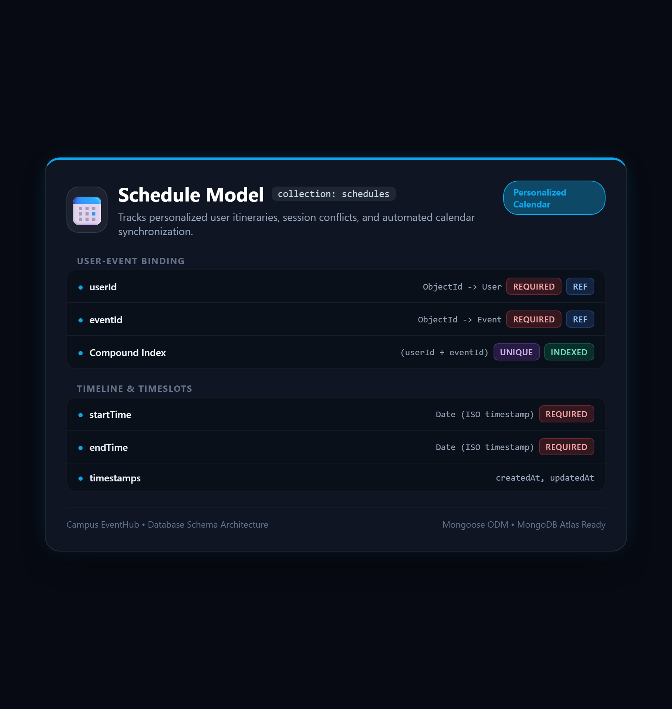
</div>

- **Key Highlights**:
  - Personal session calendar for attendees with conflict detection.
  - Compound unique index on `(userId + eventId)`.
  - Integrates with `.ics` calendar exports for Apple and Google Calendar.
</details>

<details>
<summary><b>6. Notification Model (<code>notifications</code>)</b> — Real-Time Alerts & Deep Links</summary>

<br>

<div align="center">
  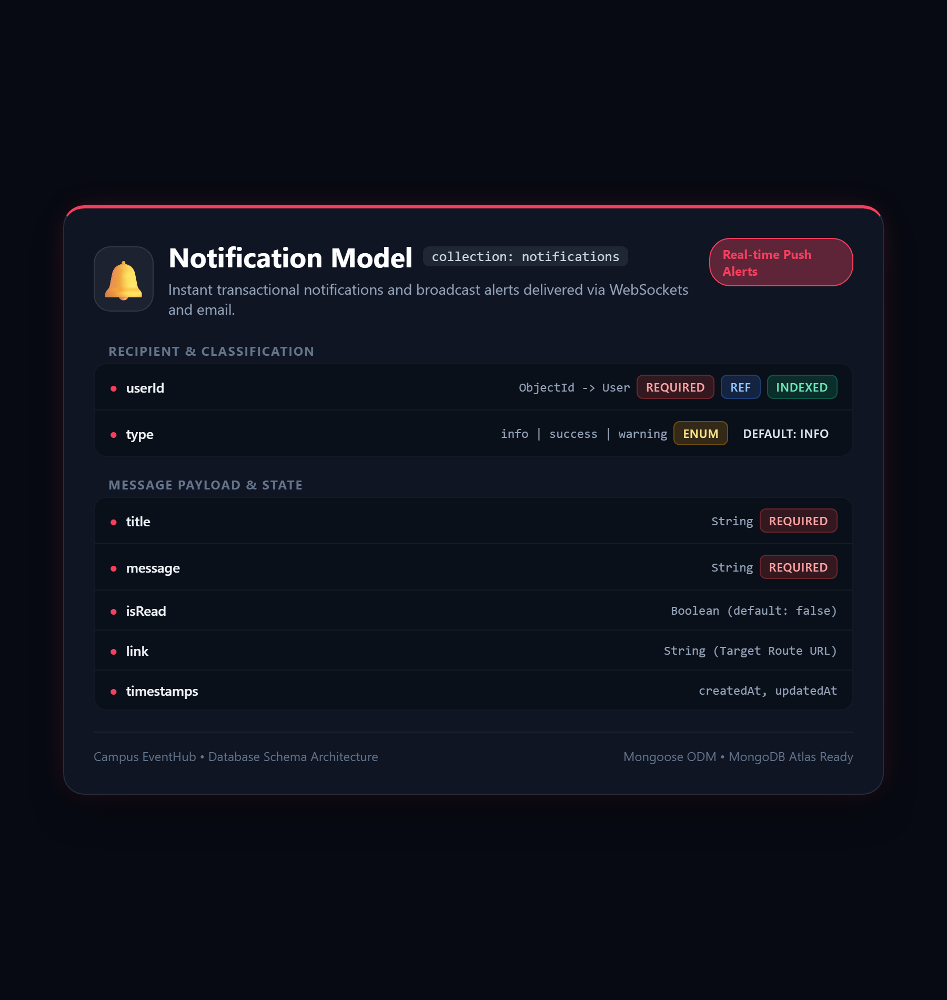
</div>

- **Key Highlights**:
  - Real-time push alerts via Socket.IO for event updates, reminders, and broadcast messages.
  - Typed categorization (`info`, `success`, `warning`) with deep links to specific application pages.
</details>

<details>
<summary><b>7. Log Model (<code>logs</code>)</b> — Audit Trail & Automatic TTL Pruning</summary>

<br>

<div align="center">
  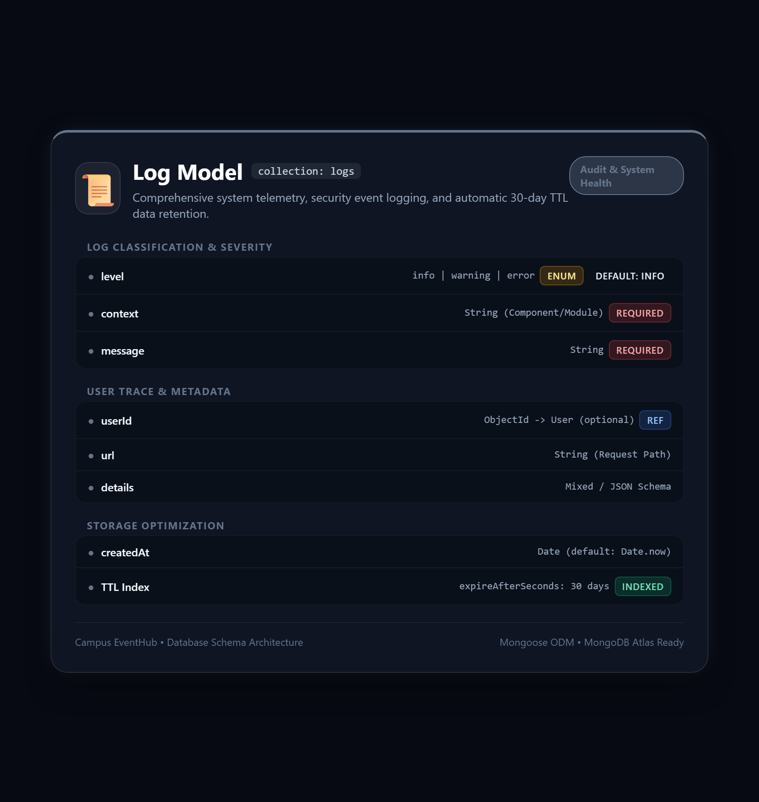
</div>

- **Key Highlights**:
  - Centralized security and error tracking (`info`, `warning`, `error`).
  - **Automatic 30-Day TTL Index**: MongoDB automatically deletes logs older than 30 days (`expireAfterSeconds: 2592000`).
</details>

<details>
<summary><b>8. Admin Model (<code>admins</code>)</b> — System Governance & Access Control</summary>

<br>

<div align="center">
  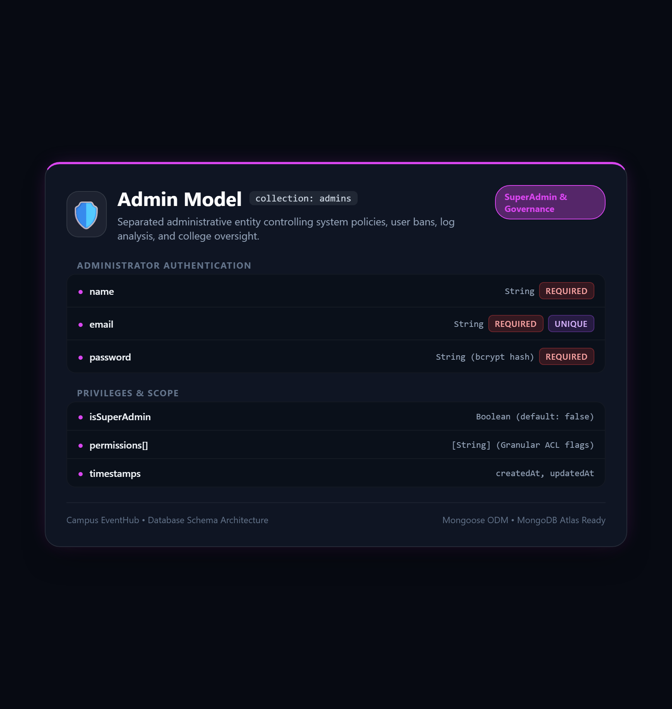
</div>

- **Key Highlights**:
  - Isolated administrative auth table safeguarding platform governance.
  - Fine-grained permissions array and SuperAdmin privilege elevation.
</details>

---

## 💻 Live Application Previews

Captured directly from the running development instance:

| Landing Page | Features & Solutions |
| :---: | :---: |
| 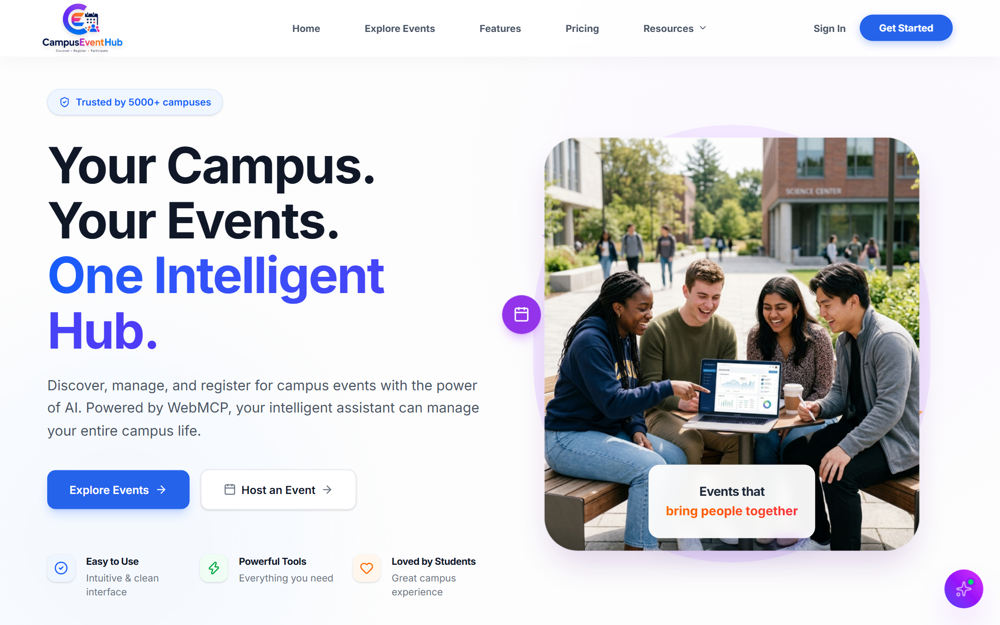 | 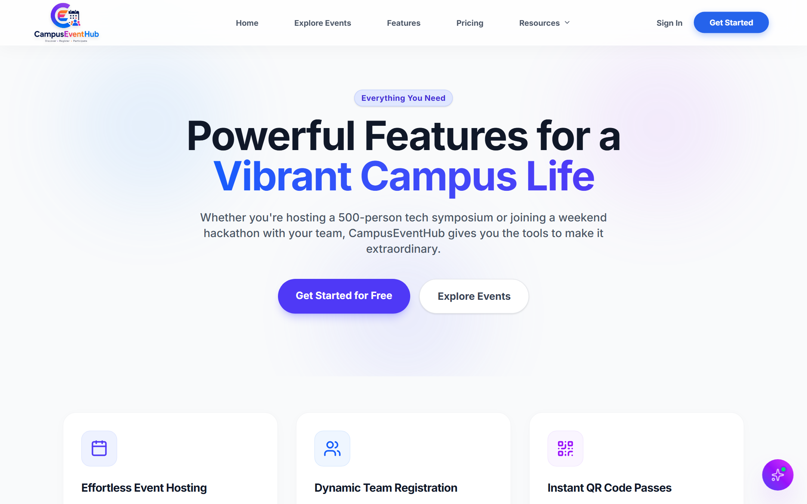 |

| Pricing & Tiers | Authentication Experience |
| :---: | :---: |
| 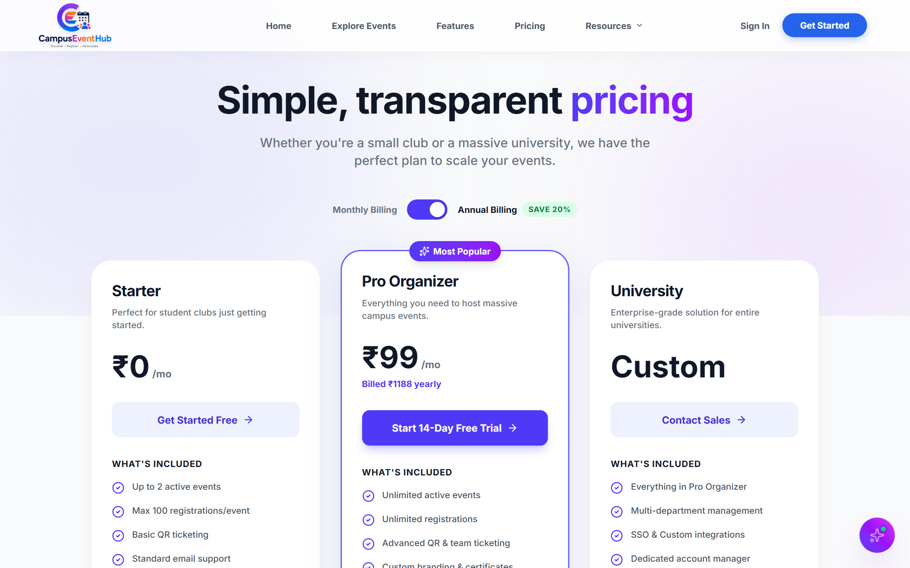 | 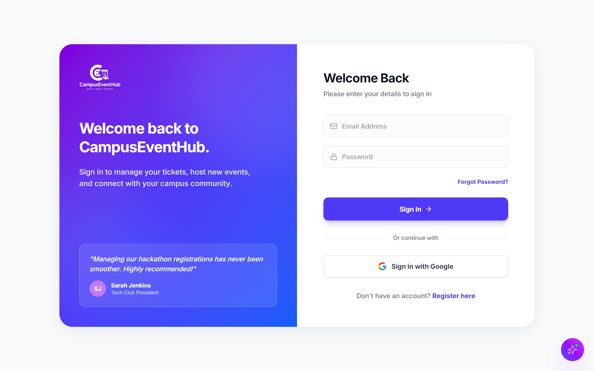 |

---

## ✨ Key Features

- **Dynamic Unified App Shell**: Single SPA (`/app`) dynamically transforming navigation and actions based on user-event relationships (`isOrganizer`, `isParticipant`, `isAdmin`).
- **Anti-Duplicate QR Check-in**: High-speed camera scanner using `html5-qrcode` to validate tickets in real-time and prevent double-entry.
- **Interactive Live Q&A**: Socket.IO bi-directional WebSocket messaging between event attendees and coordinators.
- **AI Identity Verification**: OCR-based student ID card reading and live selfie validation.
- **Hackathon Management**: Problem statement preference selection, unique team join codes, and project submission pipeline.
- **Background Reminders**: Node-Cron automated 24-hour reminder email triggers with Nodemailer.
- **PDF Ticket & Pass Generation**: Client-side ticket printing with `jspdf` and QR code embedding.
- **Enterprise Security**: Helmet HTTP headers, express rate limiting, mongo-sanitize, and XSS sanitization.

---

## 🛠️ Tech Stack

- **Frontend**: React 19, Vite, Tailwind CSS 4, React Router 7, Recharts, Lucide Icons.
- **Backend**: Node.js, Express 5, Mongoose 9, Socket.IO, Nodemailer, Node-Cron, Multer.
- **Database**: MongoDB (Atlas & local instance support).
- **AI Microservice**: Python FastAPI, Sentence-Transformers, Playwright.

---

## 🏁 Getting Started

### Prerequisites
- Node.js (v18+)
- MongoDB (Running locally on `mongodb://127.0.0.1:27017` or Atlas URI)
- Python 3.10+ (Optional, for AI microservice)

### 1. Clone & Configure
```bash
git clone https://github.com/your-username/CampusEventHub.git
cd CampusEventHub
```

### 2. Backend Setup
```bash
cd backend
npm install

# Create .env file
cat <<EOF > .env
PORT=5000
MONGO_URI=mongodb://127.0.0.1:27017/campuseventhub
JWT_SECRET=your_jwt_secret_key_here
CLIENT_URL=http://localhost:5173
EOF

npm start
```

### 3. Frontend Setup
```bash
cd ../frontend
npm install
npm run vite-dev
```

Open [http://localhost:5173](http://localhost:5173) in your browser.

---

## 📁 Project Structure

```plaintext
CampusEventHub/
├── backend/
│   ├── config/          # Database configuration
│   ├── controllers/     # REST API route controllers
│   ├── middleware/      # Auth, admin, sanitization & security middleware
│   ├── models/          # 8 Mongoose database schemas
│   ├── routes/          # Express route definitions
│   ├── services/        # Nodemailer, calendar & external services
│   ├── core.js          # Express app & Socket.IO server initialization
│   └── server.js        # Main backend entry point
├── frontend/
│   ├── public/          # Static assets & generated showcase images
│   └── src/
│       ├── components/  # Reusable UI components & layouts
│       ├── context/     # Auth, Admin & Sidebar state providers
│       ├── pages/       # React pages (Auth, Dashboard, Events, Admin)
│       └── services/    # Axios API client & interceptors
├── docs/
│   └── assets/images/   # Generated model diagrams & showcase banners
│       ├── models/      # 8 Individual model PNG cards
│       └── screenshots/ # Live app captures
├── ai_service/          # FastAPI NLP microservice
├── requirements.md      # Living requirements specification
├── architecture.md      # Living technical architecture specification
└── README.md            # Project documentation & social assets
```

---

## 📚 Living Documentation

- 📄 [Requirements Specification](requirements.md)
- 🏗️ [Technical Architecture](architecture.md)
- 📜 [License (ISC)](LICENSE)

---

<div align="center">

**Developed by Sumit Patel**  
*Built with passion for university communities worldwide.*

</div>
